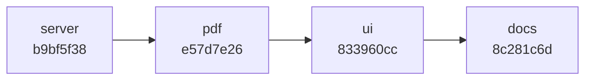

# Latest changes: the NF-e feature, in four commits

The working copy was one big pile of changes. It is now four commits, stacked
in dependency order, each one a coherent slice. The tip is green: typecheck
clean, 86 unit tests pass, UI builds.

Context: the two commits underneath these (`tickets: unify sheet slots and
guard board invariants`, `ui: derive drag preview from domain move rule`) are
the board-abstraction fixes from before. This feature sits on top of them.



## 1. `server: proxy nfe lookups and carry batch metadata` — b9bf5f38

The data and the API. Nothing here knows about drawing or the browser.

- **New `src/server/nfe.ts`** — `normalizeAccessKey` (strips non-digits, requires
  exactly 44), an `NfeLookupError` with an HTTP status + code, and
  `HttpNfeLookupClient` that calls the upstream `nfe-lookup` service.
- **`src/server/app.ts`** — adds `GET /api/nfe/:key` (proxies the lookup, 503
  `nfe-disabled` when unconfigured) and extends `POST /api/groups` with
  `nfeNumber`, `batches`, and manually typed `codes`.
- **`src/server/main.ts`** — wires the client, base URL from `NFE_LOOKUP_URL`
  (default `http://localhost:5000`, empty string disables it).
- **`src/domain/types.ts`, `group.ts`, `store.ts`** — `Group`/`Ticket` carry
  `nfeNumber` and batch codes; the duplicate-group check now also compares them.
- **Tests** — `tests/nfe.test.ts`, `tests/nfe-route.test.ts`, plus the NF-e
  cases in `tests/acceptance.test.ts`.

Why first: everything else consumes these fields.

## 2. `pdf: barcode access key and print nfe/lote identity` — e57d7e26

What a printed card actually looks like.

- **`src/pdf/pdf-lib-composer.ts`** — embeds one Code 128 barcode per access key
  (`bwip-js`), draws the CISALV watermark, puts the volume count and project on
  one line, emphasizes the município, prints the NF-e number, and lays out one
  checkbox per batch code inline (never stacked). The 44-digit key itself is
  never printed as text — only the barcode.
- **`src/pdf/logo.ts` + `imgs/gray.png`** — the logo inlined as base64 so the PDF
  stays byte-deterministic.
- **`package.json` / `package-lock.json`** — adds `bwip-js`.
- **`tests/pdf.test.ts`** — barcode, NF-e, and lote assertions.

## 3. `ui: access-key lookup, picklists, and pt-BR copy` — 833960cc

The screen.

- **`src/ui/index.html`** — the access-key box (with *Consultar*) moved to the
  top bar. It stays tied to the form via `form="add-group"`, so submit and reset
  still see it. Adds Projeto/Município datalists, Número da NF-e, Lote(s), and
  the pt-BR copy.
- **`src/ui/main.ts`** — the lookup: fills the form from a found NF-e, and now
  **auto-consults once the key reaches 44 digits**. A small guard prevents
  duplicate/in-flight lookups. Also renders NF-e number and lote on each card.
- **`src/ui/picklists.ts`** — the Projeto and Município lists.
- **`src/ui/styles.css`** — header `.lookup` layout, card `.nfe` line.
- **Tests** — `tests/e2e/board.spec.ts` (includes the lookup flow) and
  `tests/e2e/print.spec.ts` updated for the pt-BR labels.

## 4. `docs: describe the nfe feature and test workflow` — 8c281c6d

- **`README.md`** — documents the barcode/logo/identity layout, the NF-e
  integration, and how to run the unit vs Playwright suites on a weak machine.

## How to look at each one

```bash
jj show b9bf5f38          # server + domain + tests
jj show e57d7e26          # pdf
jj show 833960cc          # ui
jj show 8c281c6d          # docs
jj log -r '::@'           # the whole stack
```

## Notes

- Removed `imgs/logoblue(1).png:Zone.Identifier` — a Windows NTFS metadata
  artifact, not a real asset.
- The split is file-disjoint, so each commit compiles on its own; the order
  matters only because `pdf` and `ui` read the fields `server` introduces.
